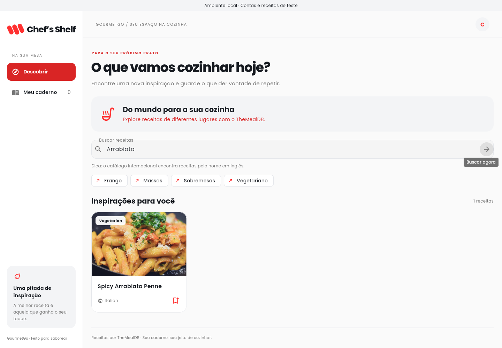

# Chef’s Shelf

**Um mundo de sabores. Um caderno só seu.**

Aplicativo Flutter da startup fictícia **GourmetGo**, desenvolvido para a Situação de Aprendizagem 1: Caderno de Receitas Digital. Descubra receitas no TheMealDB, copie as favoritas para um caderno privado no Firestore e personalize ingredientes, preparo e observações.



Outras telas: [login](docs/screenshots/01-login-desktop.png), [detalhes e personalização](docs/screenshots/03-receita-desktop.png) e [caderno no celular](docs/screenshots/04-caderno-mobile.png).

## Funcionalidades

- Cadastro com nome, e-mail e senha; login, recuperação de senha e logout com Firebase Auth.
- Busca real no TheMealDB com debounce, proteção contra respostas fora de ordem e sugestões.
- Detalhes com fotografia, categoria, origem, ingredientes e passos de preparo.
- Caderno privado com atualização em tempo real pelo Cloud Firestore.
- **CRUD completo**: salvar uma cópia, consultar, editar e remover com confirmação.
- IDs determinísticos e transação: salvar de novo não duplica nem sobrescreve suas edições.
- Busca local, filtro por categoria e ordenação por nome ou data no caderno.
- Ingredientes marcáveis durante o preparo, proteção contra descarte de edições e feedback das operações.
- Layout adaptável a celular e desktop; Android e web no mesmo código.
- Tratamento de busca vazia, erros de conexão, API indisponível, imagem ausente e falhas de autenticação.

O catálogo original está em **inglês**: pesquise por `chicken`, `pasta`, `cake` ou pelo nome de um prato. A interface está em português. A chave pública `1` do TheMealDB é destinada a desenvolvimento/uso educacional; confira os [termos da API](https://www.themealdb.com/api.php) antes de uma distribuição comercial.

## Começar localmente, sem conta Firebase

Pré-requisitos: **Flutter 3.38.10 / Dart 3.10.9**, **Node 22 ou 24**, **Java 21** e Git. A versão Flutter está em `.fvmrc`; dependências estão fixadas em `pubspec.lock` e `package-lock.json`.

```bash
git clone https://github.com/lanaro0108/ChefsShief.git
cd ChefsShief
bash scripts/install.sh
```

No ambiente de nuvem, o script usa `/workspace/tools/flutter` e mantém os caches fora do repositório. Em outra máquina, instale essa versão Flutter no PATH ou informe um diretório gravável em `FLUTTER_ROOT`. A instalação usa fontes oficiais e mantém a verificação TLS.

Inicie os emuladores em um terminal:

```bash
bash scripts/run_local.sh emulators
```

Em outro terminal:

```bash
bash scripts/run_local.sh
```

A versão web usa a porta **7357**. Portas dos emuladores: **9099** (Auth), **8080** (Firestore) e **4000** (painel). Esses endereços são locais à máquina; o onboarding não publica uma prévia automaticamente.

Crie uma conta pela interface. **Não há credenciais de demonstração predefinidas.** O projeto `demo-chefs-shelf` usa emuladores oficiais, sem acessar dados de produção. A interface indica esse modo. Os dados locais são temporários; para preservá-los, use `--import` e `--export-on-exit` da CLI.

## Conectar a um Firebase real

O código está preparado; o responsável pela conta precisa criar e configurar um projeto Firebase de produção. O modo local não cria esse projeto.

1. No [Console Firebase](https://console.firebase.google.com/), crie um projeto.
2. Em **Authentication → Sign-in method**, habilite **Email/Password**. Em **Settings → Authorized domains**, adicione os domínios de execução necessários (incluindo `localhost` para desenvolvimento, quando necessário).
3. Crie o **Cloud Firestore em modo de produção**. Escolha uma região adequada aos usuários; não comece com regras públicas.
4. Registre um app **Web** nas configurações do projeto e copie os campos públicos de `firebaseConfig`.
5. Copie `config/firebase.example.json` para `config/firebase.json` e substitua os exemplos. O arquivo local está no `.gitignore`. **Não coloque chaves de conta de serviço nele.** A configuração identifica o projeto; Auth e regras controlam a autorização.
6. Faça login na CLI na sua máquina e publique as regras no projeto escolhido:

```bash
npx firebase login
npx firebase deploy --only firestore:rules,firestore:indexes --project SEU_PROJECT_ID
```

Execute o app:

```bash
flutter run -d chrome --dart-define-from-file=config/firebase.json
```

Compile e publique a versão web de produção:

```bash
flutter build web --release --dart-define-from-file=config/firebase.json --no-web-resources-cdn
npx firebase deploy --only hosting --project SEU_PROJECT_ID
```

Não use `USE_FIREBASE_EMULATORS=true` em produção. Sem configuração, o aplicativo mostra instruções, em vez de apresentar uma sessão falsa. O Hosting tem fallback de navegação e cabeçalhos de segurança em `firebase.json`.

## Android

`android/` contém o projeto nativo com ID `com.gourmetgo.chefs_shelf`, permissão de internet e Android mínimo definido pelo Flutter (API 24). Instale Android SDK e aceite as licenças com `flutter doctor --android-licenses`. Use **JDK 21 completo (incluindo javac)**; os alvos de bytecode seguem o template oficial do Flutter.

Produção:

Registre também um app **Android** no Firebase com o pacote `com.gourmetgo.chefs_shelf`. Copie o exemplo para `config/firebase.android.json` e use os dados desse app: `FIREBASE_APP_ID` deve ser o `mobilesdk_app_id` Android (`1:...:android:...`), além do projeto, remetente e API key correspondentes. Não reutilize o App ID Web no Android. Auth e Firestore são inicializados pelas opções Dart, sem exigir alterações nos arquivos Gradle.

```bash
flutter run -d SEU_DISPOSITIVO --dart-define-from-file=config/firebase.android.json
flutter build apk --release --dart-define-from-file=config/firebase.android.json
```

### Executar pelo Android Studio ou VS Code

O arquivo `config/firebase.android.json` é carregado na compilação pela opção `--dart-define-from-file`. Os quatro campos obrigatórios são `FIREBASE_API_KEY`, `FIREBASE_APP_ID`, `FIREBASE_PROJECT_ID` e `FIREBASE_MESSAGING_SENDER_ID`; todos devem estar preenchidos com os valores do aplicativo Android registrado no Firebase.

`FIREBASE_AUTH_DOMAIN` é opcional no Android. Quando esse campo está ausente ou vazio, o aplicativo omite o domínio nas opções do SDK. Isso evita a exceção nativa `Given String is empty or null` em `FirebaseAuth.setCustomAuthDomain` durante cadastro e login. Após atualizar o código, encerre a execução anterior e inicie novamente para reinicializar o SDK nativo.

No **Android Studio**, abra **Run → Edit Configurations**, selecione a configuração Flutter de `lib/main.dart` e coloque em **Additional run args**:

```text
--dart-define-from-file=config/firebase.android.json
```

Salve, encerre a execução anterior pelo botão Stop e execute novamente. Use a raiz do projeto Flutter como diretório de trabalho. Alterações em `dart-define` exigem uma nova execução completa; hot reload não atualiza essas opções.

No **VS Code**, selecione **Chef's Shelf - Android com Firebase** em **Run and Debug**, escolha o dispositivo Android e pressione F5. Essa configuração já está em `.vscode/launch.json`.

Se aparecer **Vamos preparar a cozinha?**, pelo menos um dos quatro campos obrigatórios está vazio ou não foi passado à execução. Confira o nome do arquivo e os nomes dos campos. O JSON deve conter os campos `FIREBASE_...` descritos acima; os dados necessários podem ser obtidos no `google-services.json` nas configurações do aplicativo Android no console Firebase.

Desenvolvimento com o emulador Android padrão:

```bash
flutter run -d SEU_EMULADOR \
  --dart-define=USE_FIREBASE_EMULATORS=true \
  --dart-define=FIREBASE_EMULATOR_HOST=10.0.2.2
```

Para compilar um APK de desenvolvimento destinado a esse emulador:

```bash
flutter build apk --debug --target-platform android-arm64 \
  --dart-define=USE_FIREBASE_EMULATORS=true \
  --dart-define=FIREBASE_EMULATOR_HOST=10.0.2.2
```

`10.0.2.2` representa a máquina anfitriã do emulador Android. Em um telefone físico, use a configuração de produção ou configure o acesso aos emuladores pela sua rede; esse endereço não representa o ambiente na nuvem em outro dispositivo.

O manifesto de debug permite HTTP para tráfego local dos emuladores; a API usa HTTPS. O APK de release usa a assinatura de desenvolvimento do template: configure um keystore privado antes de distribuir em uma loja. Não versione keystores. iOS não foi incluído: requer macOS/Xcode para compilação e validação.

## Arquitetura e estado

```text
lib/
  app/                        Tema, bootstrap, configuração Firebase e sessão
  core/                       Falhas e componentes compartilhados
  features/
    auth/                     Serviço de autenticação e formulário de acesso
    recipes/
      domain/                 Modelo Recipe, validação e snapshots
      data/                   Cliente TheMealDB e repositório Firestore
      presentation/           Busca, caderno, cartões, detalhes e editor
```

O domínio não depende do Firebase. `NotebookRepository` define o contrato do caderno; `FirestoreNotebookRepository` acessa o banco e recebe dependências por construtor. A interface não faz chamadas HTTP diretamente.

`RecipeSearchController` usa `ChangeNotifier`, debounce de 450 ms e contador de requisições para impedir que uma resposta antiga substitua uma busca recente. `StreamBuilder` acompanha sessão e snapshots. O estado de formulários, carregamento e checklist fica nos widgets; controllers e listeners são descartados com a tela. A conta conectada determina o UID de todos os caminhos do caderno.

## Modelagem do Firestore

Um documento por receita em `users/{uid}/recipes/meal_{idMeal}`:

```javascript
{
  title: "Spicy Arrabiata Penne",
  ingredients: ["1 pound penne rigate", "1/4 cup olive oil", "3 cloves garlic"],
  instructions: ["Aqueça o azeite...", "Cozinhe a massa...", "Misture e sirva..."],
  imageUrl: "https://www.themealdb.com/images/media/meals/ustsqw1468250014.jpg",
  category: "Vegetarian",
  area: "Italian",
  notes: "Na próxima vez, usar menos pimenta.",
  sourceId: "52771",
  savedAt: Timestamp,
  updatedAt: Timestamp
}
```

**Ingredientes e instruções são arrays de strings**, com ordem preservada. Medidas e nomes são combinados na importação; linhas vazias são eliminadas dos passos. O texto é copiado: detalhes do caderno independem de novas consultas à API. Fotografias continuam referências remotas e têm fallback visual.

A consulta por usuário ordena por `savedAt` e usa o índice simples automático, sem índice composto. Para cadernos grandes, o próximo passo de escala é paginação; nesta entrega a lista é acompanhada integralmente para busca e filtro locais.

### Segurança e integridade

- Leitura, consulta e escrita exigem `request.auth.uid == uid` do caminho.
- Campos obrigatórios e lista fechada de campos permitidos.
- Título: 1–120 caracteres; ingredientes: 1–40 itens de 1–300 caracteres; passos: 1–40 itens de 1–5.000 caracteres; observações: até 2.000 caracteres.
- Todos os itens dos arrays são validados nas regras, inclusive posições finais. Campos extras, tipos incorretos e URLs fora do domínio de imagens da API são rejeitados.
- `savedAt` e `updatedAt` usam timestamps do servidor. `savedAt`, identificação e metadados da origem são imutáveis em edições.
- Salvar usa transação: um documento já existente é preservado. Editar e excluir também usam transações; a interface anuncia sucesso após confirmação.
- Receitas ficam na subcoleção do UID; não há coleção pública de cadernos.
- `storage.rules` **nega todo acesso**. Upload não faz parte deste cenário: imagens vêm da API. Não é necessário habilitar Storage ou Cloud Functions. Se habilitar Storage futuramente, publique suas regras antes de usá-lo.

Leituras podem usar o cache padrão do SDK em dispositivos compatíveis. API, autenticação e transações precisam de conexão. O aplicativo apresenta erros e permite tentar novamente; não promete funcionamento completo offline.

## Testes e validação

```bash
bash scripts/check.sh
```

Executa formatação, análise estática, testes Flutter com cobertura, testes de Auth/Firestore nos emuladores e compilação web. Feche emuladores já abertos para evitar colisão de portas. A CI executa esses tipos de verificação a cada push e pull request.

```bash
flutter analyze
flutter test --coverage
npm run test:rules
```

Para testar a interface compilada no navegador com API real e os emuladores oficiais do Firebase, compile a web com `USE_FIREBASE_EMULATORS=true`, feche o servidor da porta 7357 e execute:

```bash
npx firebase emulators:exec --only auth,firestore --project demo-chefs-shelf 'bash scripts/check_web.sh'
```

O teste usa Chromium/Chrome instalado (`CHROMIUM_EXECUTABLE` pode indicar o executável), cria uma conta temporária e exercita cadastro, busca, detalhes, salvamento, edição de arrays, exclusão, logout e login em desktop e celular. As capturas ficam em `/tmp/chefs-shelf-screenshots`. A versão web inclui fontes locais, sem depender de Google Fonts.

Testes Dart cobrem conversão da API, serialização, validação, respostas inválidas, falta de conexão, concorrência de buscas e edição em tela de celular. Testes de backend exercitam cadastro, login, recuperação de senha, snapshots em tempo real, CRUD, isolamento entre usuários, clientes anônimos e documentos inválidos. Não exigem credenciais de produção.

Veja [docs/ENTREGA.md](docs/ENTREGA.md) para roteiro e requisitos e [docs/VALIDACAO.md](docs/VALIDACAO.md) para resultados e limitações.

## Git e entrega

Revise `git diff` e rode os testes antes dos commits. Use mensagens para mudanças reais: `feat: adiciona caderno pessoal de receitas`, `test: valida isolamento do Firestore` ou `docs: explica execução e publicação`. A CI fica em `.github/workflows/ci.yml`. Não versione senhas, tokens administrativos, keystores ou contas de serviço.

### Identidade visual

Tipografia Poppins incluída no aplicativo (pesos 400, 500, 600, 700 e 800), licenciada sob a SIL Open Font License em `assets/fonts/Poppins-OFL.txt`. Não há download de fontes durante o uso.

Paleta: vermelho vibrante `#FF3030`, vermelho escuro `#D92525`, preto `#15191F`, branco `#FFFFFF`, fundo `#FAFAFA`, cinza claro `#F3F4F6`, texto secundário `#757575` e bordas `#E5E7EB`. Botões com texto branco usam vermelho escuro para legibilidade. O logo foi reproduzido em vetor a partir da referência fornecida, com três cápsulas vermelhas inclinadas e a assinatura Chef’s Shelf.
